# Awesome Motion Graphics

A Claude Code skill that collects motion-graphics edits for vertical talking-head video from many sources. Each recipe is a build spec that Claude turns into a Remotion composition and renders to MP4 on your own clip.

## Install

```bash
git clone <this-repo> ~/awesome-motion-graphics
ln -s ~/awesome-motion-graphics/skills/awesome-motion-graphics ~/.claude/skills/awesome-motion-graphics
```

Then in Claude Code: *"use awesome-motion-graphics: orbit on ~/Movies/me.mov"*, or just *"what edits can you do?"*

Requirements: Node.js, a vertical clip (ideally 1080x1920). Claude installs Remotion during setup.

## Layout

```
skills/awesome-motion-graphics/
  SKILL.md        workflow, defaults, troubleshooting
  setup/          house style + person mask / head track (run once)
  effects/        one recipe per file, with frontmatter
  extras/         intros, endings, assembling a full reel
```

## Previews

Previews cover the frame-15 effects so far. Each one is rendered with the inspiri.flow husky as the speaker (`preview-studio/`, `bash render-gif.sh <effect>`). Preview fidelity: the specs are approximated in CSS, and the data shown is made up.

|   |   |   |   |
|---|---|---|---|
| 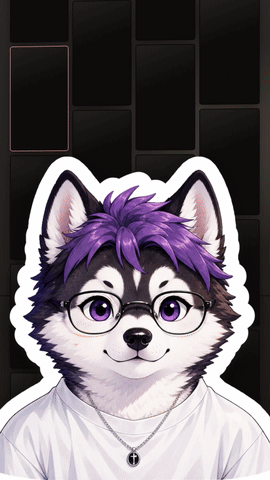<br>**reel-wall** | 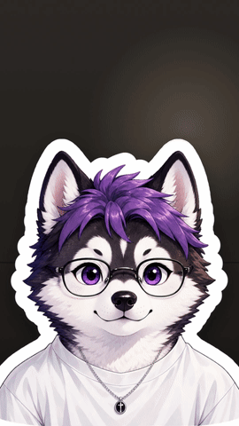<br>**glass-widgets** | 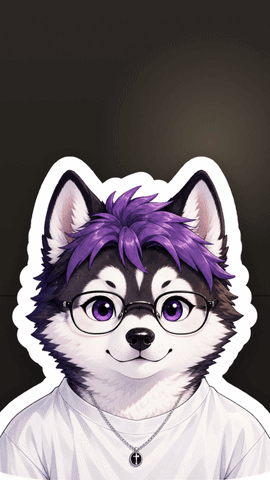<br>**kallaway** | 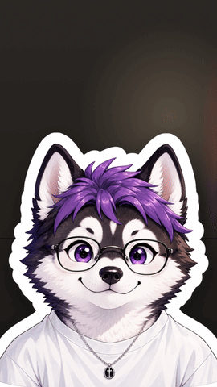<br>**orbit** |
| 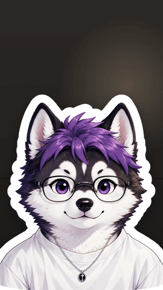<br>**billboard** | 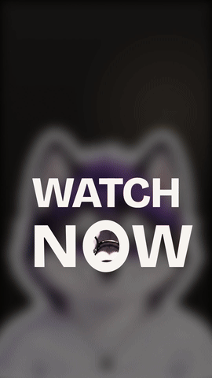<br>**zoom-through** | 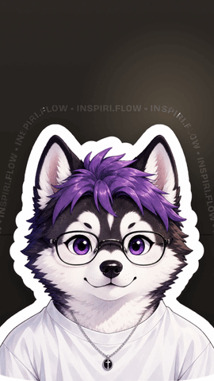<br>**text-path** | <br>**zoom-grid** |
| <br>**face-cam** | <br>**text-3d** | 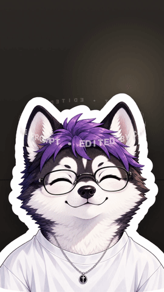<br>**text-ring** | 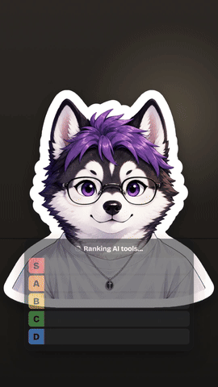<br>**tier-list** |
| 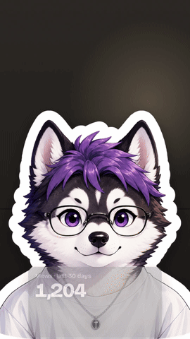<br>**glass-graph** | 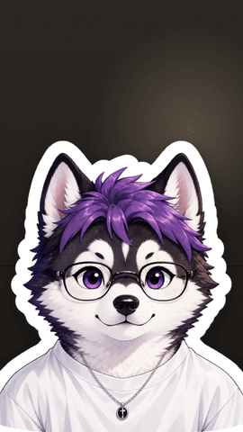<br>**over-the-shoulder** | 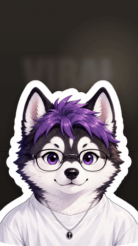<br>**text-behind** | 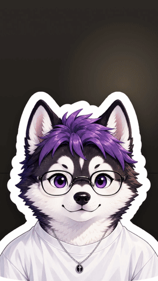<br>**stage-light** |
| <br>**glass-panels** | 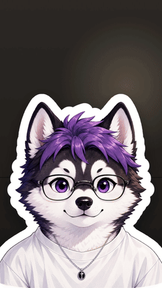<br>**reach-split** | 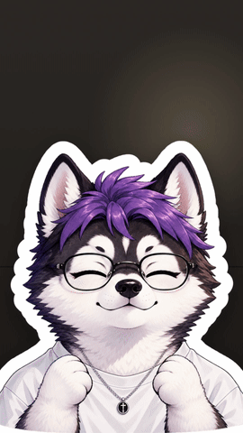<br>**reel-orbit** | <br>**pull-back** |

## Effects

| Effect | What you see | Needs | Source |
|---|---|---|---|
| reel-wall | Back wall becomes a grid of screens playing your top reels | mask, reels | frame-15 |
| glass-widgets | Smoked-glass clock, now-playing and notification at three depths | mask, music | frame-15 |
| kallaway | Shot drops into a bottom panel, head breaks out, logo + headline build above | mask | frame-15 |
| orbit | Glass like/comment/share tiles orbit your head in 3D | mask, head-track | frame-15 |
| billboard | Pull back to reveal your clip on a city-tower LED billboard at night | – | frame-15 |
| zoom-through | Fly through the O of a giant word into your shot | – | frame-15 |
| text-path | Text flows along the outline of your head and shoulders | mask | frame-15 |
| zoom-grid | Pull back to a wall of your moments, glide, dive into another | – | frame-15 |
| face-cam | Creator panel layout with head break-out and headline | mask, head-track | frame-15 |
| text-3d | Solid 3D word standing on the desk | – | frame-15 |
| text-ring | Ring of text spinning around your head in 3D | mask, head-track | frame-15 |
| tier-list | Tier list builds itself below your face | – | frame-15 |
| glass-graph | Frosted card with count-up number and self-drawing graph | – | frame-15 |
| over-the-shoulder | Camera pushes over each shoulder as BEFORE/AFTER cards pop | mask | frame-15 |
| text-behind | Huge word rises from behind your head | mask | frame-15 |
| stage-light | Room goes dark, spotlight lands, word projected on the wall | mask | frame-15 |
| glass-panels | Glass panels behind you show the prompt, cuts, mask and export | mask | frame-15 |
| reach-split | Reach chart on a chalk board above, your shot fades in below | – | frame-15 |
| reel-orbit | Your reel covers orbit your head with real view counts | mask, head-track, reels | frame-15 |
| pull-back | Your shot becomes the monitor of an editing suite with a real timeline | music | frame-15 |
| pile-up | Reels or your headlines pile up behind your head, total pops in front | mask, reels | vibha-51 |
| fan | Tiles, phones or covers fan out in an arc around you | mask, reels | vibha-51 |
| locked-on | Brackets snap onto your face, camera follows you | head-track | vibha-51 |
| punch-in | Fast punch on a word, slow cinematic push, or punch + headline | head-track | vibha-51 |
| receipt | Your instructions print out of the wall like a receipt | mask | vibha-51 |
| grade | Colour grade fades in, or a before/after slider reveals it | – | vibha-51 |
| checklist | To-do card, Claude task list or iPhone toggles tick off as you talk | mask, head-track | vibha-51 |
| comment-box | IG comments sheet types your word, posts it, you reply | mask | vibha-51 |
| follow-tap | Follow button flips to Following | head-track | vibha-51 |
| pause-point | Freeze frame with a hand-drawn arrow and label | head-track | vibha-51 |
| uninstall | Uninstall bar fills while the frame glitches apart | – | vibha-51 |
| shortcut-rain | Keycaps rain down behind you | mask | vibha-51 |
| stamp | Red rubber stamp slams down, frame shakes | head-track | vibha-51 |
| countdown-flip | 3, 2, 1 split-flap clock above your head | mask | vibha-51 |
| rabbit-hole | Room tunnels into itself, spinning, you stay in front | mask | vibha-51 |
| cover-star | You become a magazine cover | mask | vibha-51 |
| scribble | Marker doodles draw themselves around you | head-track | vibha-51 |
| dot-reveal | Your shot builds out of glowing dots | – | vibha-51 |
| match-cut | News pages cut on one word locked behind your head | mask | vibha-51 |
| messages | iMessage banners pop in and stack up | – | vibha-51 |
| tape-label | Yellow tape with your line lands on your chest | head-track | vibha-51 |
| select-resize | Selection box grabs your number, cursor drags it bigger | mask | vibha-51 |
| wave-trim | Silence on your waveform trims away | mask | vibha-51 |
| check-pills | Grid-paper room, reel boards behind, cursor clicks pills | mask, reels | vibha-51 |

## Sources

| id | Source | Notes |
|---|---|---|
| frame-15 | [FRAME: 15 video edits you can make with Claude](https://promptible.notion.site/FRAME-15-video-edits-you-can-make-with-Claude-copy-paste-prompts-4056a397f23b81bcb2d2e937d918d84c) (Promptible) | 15 edits + 5 bonus, setup, chat intro. Recipes here are restructured specs; see the original for the full copy-paste prompts. |
| vibha-51 | [claude-video-effects](https://github.com/Vibha-Ramprakash/claude-video-effects) by Vibha Ramprakash ([@vibha.in.progress](https://instagram.com/vibha.in.progress)), MIT | 51 effects as a runnable Python/ffmpeg renderer. 24 added here as specs; the other 27 match effects already listed (orbit, carousel-spin → reel-orbit; profile-wall → reel-wall; place-in-grid → zoom-grid; spotlight, led-sign, glitter-spotlight → stage-light; backdrop-word, huge-strike, crayon-write, red-collage, pastel-word → text-behind; split-headline → kallaway; broll-split → reach-split; reel-frame, timeline → pull-back; liquid-glass-graph → glass-graph; plus glass-widgets, tier-list, over-the-shoulder-zoom). |

## Adding a source

1. Add a row to **Sources** with a short id.
2. One file per effect in `effects/`, using the frontmatter in `SKILL.md` and `source: <id>`.
3. Add it to the **Effects** table.

## Credits

- vibha-51 recipes are adapted from [claude-video-effects](https://github.com/Vibha-Ramprakash/claude-video-effects), © 2026 Vibha Ramprakash, MIT License.
- Preview music: "Sneaky Snitch" by Kevin MacLeod (incompetech.com), licensed under CC BY 4.0.
